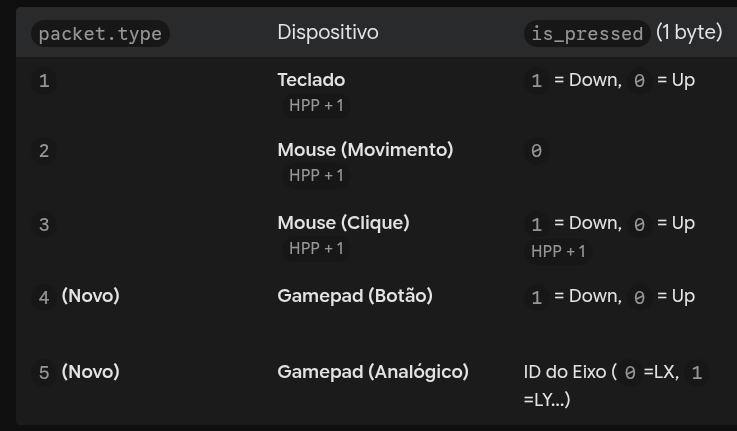
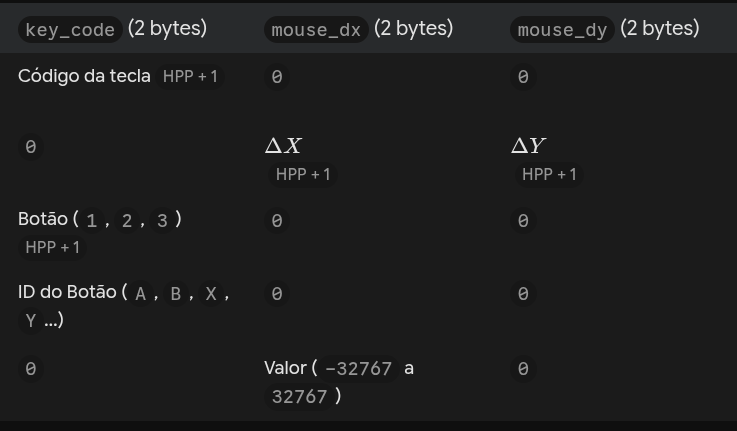
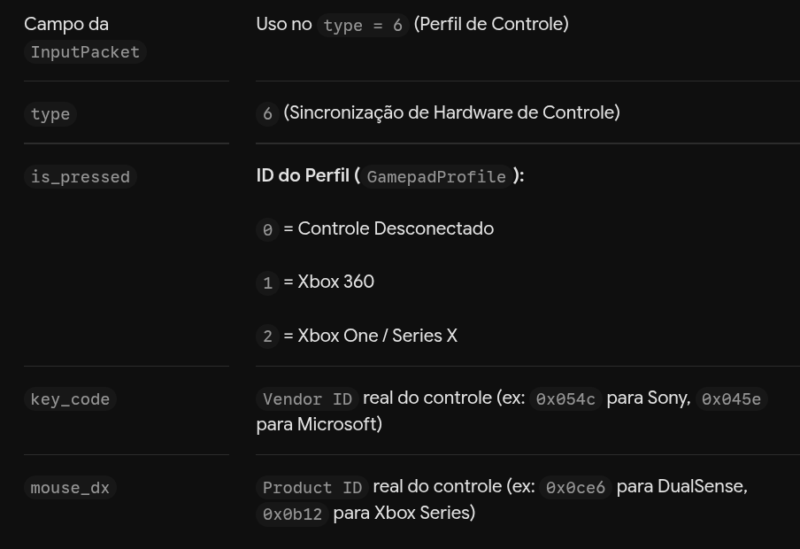

EOS - End of Stream. 

Wayland com o PipeWire

ESTATUS: 
    O pipewiresrc é "cego": Ele é um componente de captura bruto. Se você não disser a ele exatamente qual ID de tela capturar, ele puxa o "nó de vídeo padrão" do sistema. Como o Wayland bloqueia a tela, esse nó padrão geralmente é uma webcam vazia, tampada, ou um "nó fantasma" (tela preta). Por isso gerou um arquivo de 5MB: ele gravou 5MB de tela preta com sucesso.

    O Pop-up exige código D-Bus: O pipewiresrc não tem a capacidade nativa de desenhar o pop-up de permissão na tela. Para que aquele pop-up do portal apareça em um programa escrito do zero em C/C++, você teria que programar manualmente (usando bibliotecas como GDBus ou sd-bus) toda a negociação com o Linux: abrir uma sessão segura, invocar a interface org.freedesktop.portal.ScreenCast, pedir a permissão do usuário, receber o número de ID (Node ID) do monitor selecionado e, só então, injetar esse ID dentro do pipewiresrc no GStreamer. É por isso que o Teams e o OBS conseguem: eles possuem centenas de linhas de código focadas apenas em chamar esse pop-up.

Tem verificação continua na para saber se foi plugado ou nao o controle (em um trehad em paralelo) isso é ruim, podemos validar isso com logica de estados e sinais:
quando houver um plug ou desplug de controle envia um sinal, assim nao precisa ficar verificando sempre e gastando computação atoa. 

Audio do demora muito pra cgar no cliente. 

extrutura dos bits que sao passados pelo cliente e serm lidos (teclado, mouse, manet)

ADICIONAR NO CLIENTE (ai quando quando for detectado controle no cliente, aparecem o sistema operacional sabe qual controle é ... ai fica do jogo se muda ou nao as fonte visuais kkk)

    E do lado do Servidor (main_server.cpp), você pode até traduzir um controle de PlayStation ou o próprio Teclado do cliente em um controle virtual de Xbox 360 no Host (usando uinput no Linux ou a biblioteca ViGEmBus no Windows, exatamente como o Parsec e o Steam Remote Play fazem).

PROXIMAS ETAPAS : 
1. Preparação Final para Teste em 2 PCs (Injeção Física + Scroll do Mouse + Tradução Win/Linux)Durante os testes em uma única máquina (127.0.0.1), deixamos as chamadas físicas do XTest comentadas no LinuxX11Injector.hpp para o servidor não sequestrar o seu próprio mouse. Para colocar um amigo jogando via rede local ou VPN:Ativar o XTest via flag de linha de comando (ex: ./host_server <IP> --live), permitindo alternar entre o modo de teste local (apenas logs) e o modo de controle físico real sem precisar recompilar.Adicionar o Scroll do Mouse (Rodinha): Essencial para trocar de armas ou dar zoom em jogos no LinuxKeyboardMouseController.hpp (botões 4 e 5 do X11) e no WindowsKeyboardMouseController.hpp (WM_MOUSEWHEEL).   Tradução de Teclas Windows $\rightarrow$ Linux: Caso o seu amigo rode o cliente no Windows conectando no seu servidor Linux, adicionar o conversor de Virtual-Key para KeySym no LinuxX11Injector.hpp.   
            OK--------

2. Codificação de Vídeo via Hardware (GPU) no Servidor Linux (NVENC / VA-API)Hoje o servidor Linux usa o codificador via processador (x264enc speed-preset=ultrafast), o que consome CPU que deveria estar livre para rodar o jogo.Podemos adicionar uma detecção automática no DesktopScreenPipelineBuilder que verifica se o seu Linux possui placa NVIDIA (nvh264enc) ou AMD/Intel (vaapih264enc) disponível no GStreamer e usa o chip dedicado da placa de vídeo, caindo para o x264enc apenas se não houver GPU compatível. Isso reduz a carga de CPU da transmissão para menos de 2%.

3. Vibração do Controle (Force Feedback / Rumble) Reversa (Servidor $\rightarrow$ Cliente)Como o seu controle virtual Xbox Series no Linux é criado via /dev/uinput, o Kernel permite ativar a flag UI_SET_FFBIT (FF_RUMBLE):Quando você leva um tiro ou bate o carro no jogo rodando no servidor, o jogo envia a força dos motores de vibração (forte/fraco) para o /dev/uinput.O servidor lê esse evento e envia um pacote UDP de retorno para o cliente acionar o motor físico do seu controle de Xbox Series na sua mão. 
            OK - Aqui ainda queroextrair 100% de cada controle. 

4. Gateway Web (Jogar pelo Navegador via WebRTC)Criar uma nova estratégia de pipeline (WebRTCPipelineBuilder) usando o plugin webrtcbin do GStreamer e DataChannels para que qualquer pessoa possa abrir uma página HTML5 no Chrome/Firefox e jogar no seu servidor sem precisar compilar ou instalar o game_client. 

MELHORIA: ter 2 opção 
    opção 1 : o dono (jogador sever) poder ser host e jogar junto com outro jogador (cliente remoto) , entao ele teria de ver os quadros na tela e enviar os dados por rede.
    opção 2: focar no maximo de eficiencia, onde os quasro processados ja seriam injados diretamente na rede, e o computador host nao precisaria reprocessar e empacotar os dados (som e imagem) pois nesse modo estariam focados na qualidade e velocidade de quem esta remoto 

    COMO SERA FEITO:
    O gargalo atual (Cópia GPU $\rightarrow$ RAM $\rightarrow$ GPU): Hoje, o ximagesrc tira uma foto da tela e copia os pixels da memória de vídeo (VRAM) para a memória RAM do processador; o videoconvert converte as cores na CPU e, em seguida, devolve o quadro para a GPU codificar no vah264enc.   Como a sua arquitetura já suporta as 2 opções no futuro: Como isolamos a construção do pipeline na interface IMediaPipelineBuilder, quando formos implementar essas duas opções não precisaremos mexer em uma única linha de rede ou de controles:   
    Modo 1 (Host Joga Junto / Remote Play Together): O servidor mantém o monitor ligado e usa compartilhamento de memória de vídeo (DMA-BUF no Linux ou d3d11screencapturesrc ! d3d11convert no Windows) para duplicar o quadro para a rede sem passar pela RAM.
    Modo 2 (Dedicado Zero-Copy / Headless): O jogo renderiza direto em um buffer virtual na VRAM acoplado ao codificador (vah264enc / nvh264enc), sem gastar recursos desenhando no monitor físico do servidor.